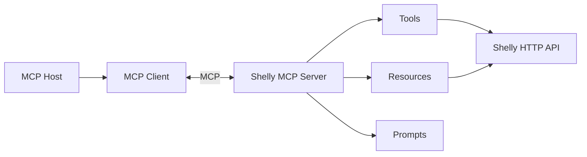

# Tworzenie agentów AI w .NET

## Laboratorium 05 — Model Context Protocol (MCP)

### Jak udostępniać narzędzia, dane i instrukcje aplikacjom AI?

---

**Marcin Sulecki**  
marcin.sulecki@pw.edu.pl

## Cel laboratorium

Podczas poprzedniego laboratorium poznaliśmy **Tool Calling** — mechanizm pozwalający modelowi językowemu wybierać i wywoływać funkcje udostępnione przez aplikację.

Tym razem zajmiemy się **Model Context Protocol (MCP)**.

MCP pozwala aplikacjom udostępniać swoje możliwości w ustandaryzowany sposób, niezależnie od konkretnego modelu językowego.

Poznamy trzy podstawowe mechanizmy:

| Mechanizm | Przeznaczenie | Przykład Shelly |
|---|---|---|
| **Tools** | Wykonywanie operacji | Włącz lampkę |
| **Resources** | Udostępnianie danych i kontekstu | Odczytaj informacje o urządzeniu |
| **Prompts** | Udostępnianie szablonów interakcji | Przygotuj raport zużycia energii |

**Pytanie przewodnie:**

> Kiedy udostępnić funkcję jako Tool, kiedy dane jako Resource, a kiedy instrukcję jako Prompt?

## 1. Architektura MCP

W architekturze MCP występują trzy podstawowe elementy:

- **MCP Host** — aplikacja zarządzająca połączeniami z serwerami MCP.
- **MCP Client** — komponent komunikujący się z serwerem MCP.
- **MCP Server** — aplikacja udostępniająca Tools, Resources i Prompts.



**Ważne:** serwer MCP nie wymaga modelu językowego.

Możemy komunikować się z nim bezpośrednio, wykorzystując MCP Inspector.

## 2. Przykład — Shelly

Wykorzystamy znane z poprzedniego laboratorium inteligentne gniazdko Shelly Plug S Gen3.

W repozytorium Shelly znajdują się przykłady:

| Projekt | Przeznaczenie |
|---|---|
| `00-Shelly.Simulator` | Symulator urządzenia Shelly |
| `03-Shelly.Mcp` | Serwer MCP |
| `04-Shelly.McpClient` | Klient MCP |

Serwer MCP komunikuje się z urządzeniem przez HTTP API.

Klient MCP odkrywa możliwości serwera i może udostępniać narzędzia modelowi językowemu.

## 3. Tools

Tools umożliwiają klientowi MCP wykonywanie operacji udostępnionych przez serwer.

Przykładowe narzędzia:

- włączenie lampki,
- wyłączenie lampki,
- odczyt aktualnego stanu,
- odczyt poboru mocy.

W aplikacji korzystającej z LLM model może wybrać odpowiednie narzędzie na podstawie polecenia użytkownika.

Przykład:

> Włącz lampkę.

Model wybiera narzędzie, a klient MCP przekazuje wywołanie do serwera.

## 4. Resources

Resources służą do udostępniania danych i kontekstu.

Mogą reprezentować między innymi:

- dokumenty,
- pliki,
- konfigurację,
- informacje o urządzeniach,
- dane udostępniane przez zewnętrzne systemy.

Przykładowy zasób:

```text
shelly://device/info
```

Mógłby zawierać:

```json
{
  "name": "Lampka biurkowa",
  "model": "Shelly Plug S Gen3",
  "location": "Pokój 204"
}
```

To przykładowy schemat danych, który można zaimplementować w ramach ćwiczenia.

**Pytanie:**

> Czym różni się odczyt informacji o urządzeniu przez Resource od wywołania narzędzia GetDeviceInfo?

## 5. Prompts

Prompts pozwalają serwerowi MCP udostępniać wielokrotnego użytku szablony interakcji z modelem.

Przykładowy prompt:

```text
energy-report
```

Argumenty:

- liczba godzin,
- cena energii za kWh.

Przykładowe zastosowanie:

> Przygotuj raport kosztów użytkowania lampki przez 500 godzin przy cenie 4,50 zł/kWh.

Serwer MCP może zwrócić szablon wiadomości zawierający instrukcje przygotowania raportu.

**Ważne:** MCP Prompt nie wykonuje samodzielnie obliczeń ani nie uruchamia modelu. Dostarcza wiadomości, które klient może wykorzystać podczas interakcji z LLM.

## 6. MCP Inspector

Do poznawania i testowania możliwości serwera wykorzystamy **MCP Inspector**.

Uruchomienie:

```bash
npx @modelcontextprotocol/inspector
```

Inspector umożliwia:

- odkrywanie narzędzi,
- wywoływanie narzędzi,
- przeglądanie zasobów,
- odczytywanie zasobów,
- przeglądanie dostępnych promptów,
- pobieranie promptów wraz z argumentami.

Pozwala więc testować serwer MCP bez modelu językowego.

## 7. Środowisko

Wymagane:

- .NET SDK zgodny z projektami Shelly,
- Node.js i npm,
- MCP Inspector,
- repozytorium Shelly.

Dodatkowo:

- Ollama — do eksperymentów wykorzystujących model językowy.

### Uruchomienie symulatora

```bash
dotnet run --project 00-Shelly.Simulator
```

### Uruchomienie serwera MCP

Skorzystaj z instrukcji uruchamiania projektu `03-Shelly.Mcp`.

Zwróć uwagę na wykorzystywany transport MCP oraz sposób przekazywania adresu API Shelly.

### Uruchomienie klienta MCP

```bash
dotnet run --project 04-Shelly.McpClient
```

Dokładne argumenty uruchomieniowe sprawdź w dokumentacji projektu.

## 8. Eksperymenty

| Eksperyment | Temat | Główne pytanie |
|---|---|---|
| EXP-00 | MCP Inspector | Jak odkrywać możliwości serwera MCP? |
| EXP-01 | Tools | Jak udostępnić nową operację? |
| EXP-02 | Resources | Jak udostępnić dane bez definiowania narzędzia? |
| EXP-03 | Prompts | Jak udostępnić szablon interakcji? |
| EXP-04 | MCP Client | Jak aplikacja wykorzystuje możliwości serwera? |

Szczegółowe zadania:

**[Eksperymenty — experiments.md](./experiments.md)**

## 9. Najważniejsze pytania

1. Czy MCP wymaga modelu językowego?
2. Czym różnią się Tools, Resources i Prompts?
3. Czy każde API powinno być udostępniane jako Tool?
4. Kto decyduje o wykorzystaniu Resource?
5. Czy MCP Prompt jest tym samym co instrukcja systemowa?
6. Czy dodanie nowego narzędzia wymaga zmiany kodu klienta?

## Materiały

- [Model Context Protocol](https://modelcontextprotocol.io/)
- [MCP — Tools](https://modelcontextprotocol.io/specification/2025-06-18/server/tools)
- [MCP — Resources](https://modelcontextprotocol.io/specification/2025-06-18/server/resources)
- [MCP — Prompts](https://modelcontextprotocol.io/specification/2025-06-18/server/prompts)
- [MCP Inspector](https://github.com/modelcontextprotocol/inspector)
- [Model Context Protocol — C# SDK](https://github.com/modelcontextprotocol/csharp-sdk)

## Podsumowanie

Po laboratorium powinieneś rozumieć:

1. Jak działa serwer MCP.
2. Jak odkrywać możliwości serwera.
3. Czym różnią się Tools, Resources i Prompts.
4. Jak udostępniać nowe możliwości serwera.
5. Jak testować serwer bez modelu językowego.
6. Jak klient MCP współpracuje z modelem.

> **Tool Calling pozwala modelowi wybierać działania.**
>
> **MCP pozwala aplikacjom udostępniać narzędzia, dane i szablony interakcji.**