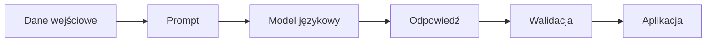

# Tworzenie agentów AI w .NET

## Wykład 02 — Modele i prompting

### Jak wybrać model językowy i wpływać na jego zachowanie?

---

**Marcin Sulecki**  
marcin.sulecki@pw.edu.pl

## Cel wykładu

Model językowy jest jednym z najważniejszych elementów systemu agentowego, ale sam wybór modelu nie gwarantuje poprawnego działania aplikacji.

Na jego zachowanie wpływają między innymi: możliwości modelu, sposób formułowania instrukcji, dostarczony kontekst oraz parametry generowania.

Podczas wykładu zastanowimy się, **jak świadomie wybierać modele i projektować prompty**, zamiast polegać na przypadkowych eksperymentach.

Poznamy:

1. **Modele językowe** — czym różnią się modele i jak wybrać odpowiedni?
2. **Modele lokalne i chmurowe** — jakie są ich zalety i ograniczenia?
3. **Prompting** — jak przekazywać modelowi instrukcje?
4. **Structured Output** — jak uzyskiwać odpowiedzi w określonym formacie?
5. **Parametry generowania** — jak wpływają na zachowanie modelu?
6. **Ewaluacja** — jak sprawdzić, czy wybrany model i prompt działają poprawnie?

## 1. Czy większy model zawsze jest lepszy?

Wyobraźmy sobie aplikację analizującą notatki kurierów.

Przykładowa notatka:

> Drugie piętro, winda jest, wejście od podwórka.

Chcemy uzyskać:

```json
{
  "floor": 2,
  "hasElevator": true
}
```

Czy do wykonania takiego zadania potrzebujemy największego dostępnego modelu?

A może mniejszy model lokalny będzie wystarczający?

**Kluczowa myśl:** najlepszy model to niekoniecznie największy model, ale taki, który spełnia wymagania konkretnego zadania.

## 2. Jak wybrać model?

Modele językowe różnią się między innymi:

- jakością odpowiedzi,
- obsługiwanymi językami,
- zdolnością rozumowania,
- wielkością okna kontekstowego,
- szybkością generowania,
- wymaganiami sprzętowymi,
- kosztem użytkowania,
- obsługą dodatkowych możliwości, takich jak Structured Output i Tool Calling.

### Modele lokalne i chmurowe

| Kryterium | Model lokalny | Model chmurowy |
|---|---|---|
| Uruchomienie | Na własnym komputerze lub serwerze | Przez API dostawcy |
| Koszt | Sprzęt i energia | Zależny od wykorzystania API |
| Prywatność | Dane mogą pozostać lokalnie | Dane są przekazywane do usługi zewnętrznej |
| Wydajność | Zależna od dostępnego sprzętu | Zależna od modelu i usługi |
| Dostępność | Możliwa praca bez Internetu | Zazwyczaj wymagane połączenie z usługą |
| Kontrola | Większa kontrola nad środowiskiem | Ograniczona do możliwości udostępnionych przez dostawcę |

### Ollama

Do uruchamiania modeli lokalnych wykorzystamy **Ollama**.

Przykładowe polecenia:

```bash
ollama pull gemma3:4b
ollama pull qwen3:4b
```

Uruchomienie modelu:

```bash
ollama run qwen3:4b
```

Ollama udostępnia również API HTTP, dzięki któremu możemy korzystać z modeli we własnych aplikacjach.

**Pytanie:** czy ten sam model będzie równie dobry do prowadzenia rozmowy, generowania kodu i wydobywania informacji z dokumentów?

## 3. Czym jest prompt?

Prompt to instrukcja lub zestaw informacji przekazywanych modelowi.

Może zawierać:

- opis zadania,
- kontekst,
- ograniczenia,
- oczekiwany format odpowiedzi,
- przykłady poprawnych wyników.

### Przykład

Użytkownik przekazuje notatkę:

> Trzecie piętro, windy brak.

Prompt:

> Określ piętro i informację o dostępności windy.

Model może odpowiedzieć:

> Lokal znajduje się na trzecim piętrze i nie ma windy.

Taka odpowiedź jest zrozumiała dla człowieka, ale niekoniecznie wygodna do dalszego przetwarzania przez aplikację.

Możemy więc doprecyzować instrukcję:

> Na podstawie notatki określ numer piętra i dostępność windy.
> Zwróć wyłącznie obiekt JSON z polami `floor` i `hasElevator`.
> Nie zgaduj brakujących informacji.

**Pytanie:** czy samo dopisanie instrukcji gwarantuje, że model zawsze zwróci poprawny JSON?

## 4. Zero-shot, One-shot i Few-shot

Jednym ze sposobów wpływania na zachowanie modelu jest dostarczenie przykładów.

### Zero-shot

Model otrzymuje wyłącznie instrukcję.

> Wyodrębnij piętro i informację o windzie z notatki.

### One-shot

Model otrzymuje instrukcję i jeden przykład.

```text
Notatka: Drugie piętro, winda jest.

Wynik:
{"floor": 2, "hasElevator": true}

Notatka: Trzecie piętro, windy brak.

Wynik:
```

### Few-shot

Model otrzymuje kilka przykładów.

```text
Notatka: Parter, bez windy.
Wynik: {"floor": 0, "hasElevator": false}

Notatka: Czwarte piętro, jest winda.
Wynik: {"floor": 4, "hasElevator": true}

Notatka: Drugie piętro, windy brak.
Wynik:
```

**Pytanie:** czy dodanie większej liczby przykładów zawsze poprawia jakość odpowiedzi?

## 5. Structured Output

W aplikacjach często potrzebujemy danych, które można przetwarzać automatycznie.

Zamiast odpowiedzi w języku naturalnym oczekujemy określonej struktury.

Przykład:

```json
{
  "floor": 3,
  "hasElevator": false
}
```

### Dlaczego to ważne?

Odpowiedź modelu może być przekazana do:

- aplikacji .NET,
- bazy danych,
- systemu analitycznego,
- kolejnego etapu przetwarzania,
- innego komponentu systemu agentowego.

Warto rozróżnić:

1. **Instrukcję w prompcie** — prosimy model o określony format.
2. **Structured Output** — wykorzystujemy mechanizmy API pozwalające wymusić lub ograniczyć strukturę odpowiedzi, zależnie od możliwości modelu i dostawcy.
3. **Walidację** — aplikacja sprawdza, czy otrzymane dane spełniają wymagania.

> **Poprawny JSON nie oznacza poprawnych danych.**

Model może zwrócić prawidłową strukturę zawierającą błędne informacje.

## 6. Temperature i inne parametry

Na zachowanie modelu wpływają również parametry generowania.

Jednym z nich jest **temperature**.

W uproszczeniu:

- niższa wartość zwykle sprzyja bardziej przewidywalnym odpowiedziom,
- wyższa wartość zwykle zwiększa różnorodność generowanych odpowiedzi.

Wpływ tego parametru zależy jednak od konkretnego modelu i sposobu generowania.

### Eksperyment myślowy

Uruchamiamy ten sam model z tym samym promptem, ale zmieniamy temperature.

Czy otrzymamy identyczne wyniki?

Czy niższa temperature gwarantuje poprawność?

Czy wyższa temperature jest zawsze niepożądana?

**Kluczowa myśl:** parametry generowania należy dobierać do zadania i weryfikować eksperymentalnie.

## 7. Jak oceniać wyniki modelu?

Załóżmy, że chcemy porównać dwa modele analizujące notatki kurierów.

Model A działa szybciej.

Model B częściej zwraca poprawne odpowiedzi.

Który powinniśmy wybrać?

To zależy od wymagań aplikacji.

### Przykładowe kryteria

| Kryterium | Co mierzymy? |
|---|---|
| Poprawność | Czy model prawidłowo rozpoznaje informacje? |
| Zgodność ze schematem | Czy wynik ma oczekiwaną strukturę? |
| Czas odpowiedzi | Jak długo trwa przetwarzanie? |
| Koszt | Ile kosztuje przetworzenie danych? |
| Stabilność | Czy model daje podobne wyniki przy kolejnych uruchomieniach? |
| Obsługa brakujących danych | Czy model potrafi przyznać, że nie zna odpowiedzi? |

### Przykładowe problemy

Notatka:

> Wejście od podwórka, kod 1234.

Nie zawiera informacji o piętrze ani windzie.

Co powinien zwrócić model?

Czy powinien zgadywać?

Czy brak informacji o windzie oznacza, że windy nie ma?

**Pytanie:** jak odróżnić brak informacji od informacji o braku windy?

## 8. Model i prompt to elementy systemu

W rzeczywistej aplikacji wynik zależy nie tylko od modelu.



Na jakość rozwiązania wpływają:

- jakość danych wejściowych,
- wybór modelu,
- konstrukcja promptu,
- parametry generowania,
- sposób przetwarzania odpowiedzi,
- walidacja wyników.

Dlatego nie wystarczy zapytać:

> Który model jest najlepszy?

Lepiej zapytać:

> Który model, z jakim promptem i przy jakich parametrach najlepiej rozwiązuje nasz problem?

## 9. Ograniczenia modeli językowych

Nawet dobrze dobrany model może:

- zwrócić błędną odpowiedź,
- wygenerować nieistniejące informacje,
- nie zastosować się do instrukcji,
- błędnie zinterpretować dane,
- zwrócić odpowiedź w nieoczekiwanym formacie.

Nie wszystkie problemy da się rozwiązać przez zmianę promptu.

Czasami potrzebujemy:

- lepszych danych,
- walidacji,
- klasycznych algorytmów,
- dostępu do aktualnych informacji,
- dodatkowych narzędzi.

**Pytanie:** co zrobić, jeśli model potrzebuje informacji, których nie ma w prompcie ani w swojej wiedzy?

## Podsumowanie

Po wykładzie powinieneś rozumieć:

1. Jakie kryteria uwzględnić przy wyborze modelu.
2. Czym różnią się modele lokalne i chmurowe.
3. Jak konstruować prompty.
4. Czym są Zero-shot, One-shot i Few-shot.
5. Dlaczego Structured Output jest ważny w aplikacjach.
6. Jak parametry generowania wpływają na wyniki.
7. Dlaczego modele i prompty należy oceniać eksperymentalnie.

### Najważniejsze wnioski

> **Nie istnieje jeden najlepszy model do wszystkich zadań.**
>
> **Dobry prompt nie zastępuje poprawnej architektury aplikacji.**
>
> **Jakość rozwiązania należy mierzyć, a nie oceniać wyłącznie na podstawie pojedynczej odpowiedzi.**

## Materiały

- [Ollama — dokumentacja](https://docs.ollama.com/)
- [Ollama — biblioteka modeli](https://ollama.com/library)
- [OpenAI — Prompt Engineering](https://platform.openai.com/docs/guides/prompt-engineering)
- [OpenAI — Structured Outputs](https://platform.openai.com/docs/guides/structured-outputs)
- [Microsoft.Extensions.AI](https://learn.microsoft.com/dotnet/ai/microsoft-extensions-ai)

## Laboratorium

Podczas [Laboratorium 03 — Modele i prompting](../../labs/03-models-and-prompting/readme.md)
porównamy modele lokalne, prompty i parametry generowania.

Wykorzystamy rzeczywiste notatki kurierów, z których będziemy wydobywać
ustrukturyzowane informacje.

Sprawdzimy, jak wybór modelu i sposób formułowania instrukcji
wpływają na jakość uzyskiwanych wyników.

## Na kolejnym wykładzie

### Tool Calling i MCP — jak udostępnić modelowi narzędzia?

Dotychczas model odpowiadał na pytania na podstawie swojej wiedzy
i informacji przekazanych w prompcie.

A co, jeśli zapytamy:

> Czy lampka w moim pokoju jest teraz włączona?

Model nie zna aktualnego stanu urządzenia.

Możemy jednak udostępnić mu narzędzie, które odczyta tę informację.

Na kolejnym wykładzie zobaczymy:

- jak model wybiera i wywołuje narzędzia przez **Tool Calling**,
- jak aplikacja wykonuje operacje wskazane przez model,
- jak **MCP** pozwala udostępniać narzędzia różnym aplikacjom.

**[Wykład 03 — Tool Calling i MCP →](../03-tool-calling/README.md)**

> **Co zrobić, gdy model nie zna odpowiedzi, ale może wykonać działanie, które pozwoli ją uzyskać?**