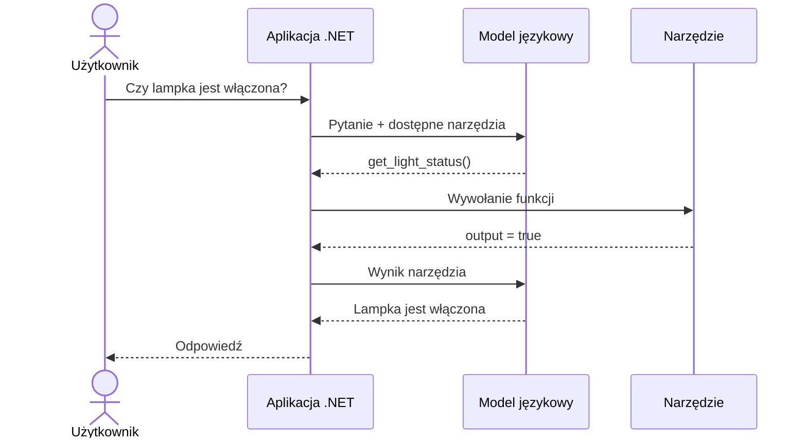
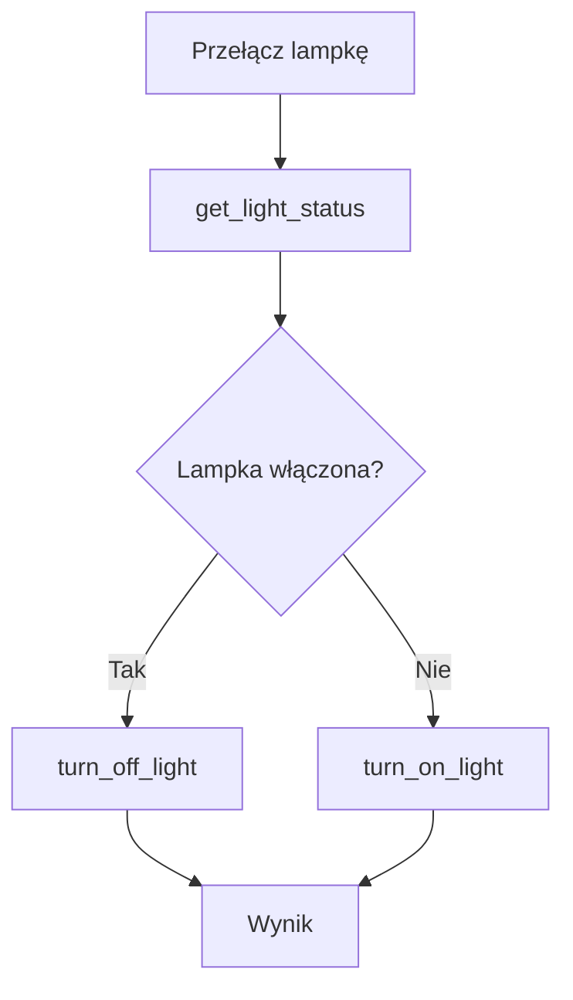

# Tworzenie agentów AI w .NET

## Wykład 03 — Tool Calling

### Jak sprawić, żeby model językowy nie tylko odpowiadał, ale również działał?

---

**Marcin Sulecki**  
marcin.sulecki@pw.edu.pl

## Cel wykładu

Model językowy potrafi interpretować polecenia i generować odpowiedzi, ale sam w sobie nie ma bezpośredniego dostępu do urządzeń, baz danych ani systemów zewnętrznych.

**Tool Calling** pozwala połączyć możliwości modelu językowego z funkcjami udostępnianymi przez aplikację.

Podczas wykładu poznamy:

1. **Tool Calling** — jak model wybiera narzędzia i przekazuje argumenty?
2. **Function Invocation** — kto faktycznie wykonuje wskazane operacje?
3. **Tool Selection** — jak model decyduje, którego narzędzia użyć?
4. **Sekwencje wywołań** — jak realizować polecenia wymagające kilku działań?
5. **Niezawodność** — jak obsługiwać błędy i weryfikować rezultaty?
6. **Bezpieczeństwo** — jak kontrolować działania inicjowane przez model?

## 1. Od rozmowy do działania

### Czy model językowy może włączyć światło?

Wyobraźmy sobie rozmowę:

> **Użytkownik:** Jest trochę ciemno. Możesz coś z tym zrobić?
>
> **Agent:** Włączyłem lampkę.

Lampka rzeczywiście się zapala.

Następnie:

> **Użytkownik:** Czy lampka jest teraz włączona?
>
> **Agent:** Tak, lampka jest włączona.

Model nie tylko odpowiada na pytania, ale uczestniczy w procesie, który prowadzi do wykonania rzeczywistego działania.

Pojawiają się jednak pytania:

- Skąd model wie, jakie działania są możliwe?
- Czy model bezpośrednio steruje urządzeniem?
- Skąd zna aktualny stan lampki?
- Kto odpowiada za wykonanie operacji?

**Pytanie przewodnie:**

> Czy model językowy naprawdę włączył lampkę?

## 2. LLM bez narzędzi

Model językowy generuje odpowiedzi na podstawie otrzymanego kontekstu i wiedzy nabytej podczas treningu.

Nie oznacza to, że zna aktualny stan świata.

Na pytanie:

> Czy lampka w moim pokoju jest teraz włączona?

model bez dostępu do odpowiednich danych nie może udzielić wiarygodnej odpowiedzi.

Porównajmy trzy mechanizmy:

| Mechanizm | Przeznaczenie |
|---|---|
| **Generowanie tekstu** | Tworzenie odpowiedzi na podstawie dostępnego kontekstu |
| **Structured Output** | Zwracanie danych w określonej strukturze |
| **Tool Calling** | Wskazywanie operacji, które aplikacja może wykonać |

**Kluczowa myśl:**

> Model nie musi znać wszystkich odpowiedzi. Może korzystać z narzędzi, aby uzyskać potrzebne informacje lub zainicjować działanie.

## 3. Jak działa Tool Calling?

Tool Calling to mechanizm, w którym model językowy może wskazać narzędzie oraz argumenty potrzebne do jego wywołania.

Przykładowe narzędzia:

- `turn_on_light` — włączenie lampki,
- `turn_off_light` — wyłączenie lampki,
- `get_light_status` — odczyt aktualnego stanu.

### Przepływ komunikacji

1. Użytkownik przekazuje polecenie.
2. Aplikacja przesyła do modelu polecenie oraz definicje dostępnych narzędzi.
3. Model wskazuje narzędzie i jego argumenty.
4. Aplikacja sprawdza żądanie i wykonuje odpowiednią funkcję.
5. Wynik wykonania trafia do modelu.
6. Model formułuje odpowiedź lub wskazuje kolejne działanie.



### Tool Calling a Function Invocation

Warto rozróżnić dwa etapy:

| Etap | Odpowiedzialność |
|---|---|
| **Tool Calling** | Model wskazuje narzędzie i argumenty |
| **Function Invocation** | Aplikacja wykonuje wskazaną funkcję |

Model nie wykonuje funkcji samodzielnie.

To aplikacja odpowiada za wykonanie operacji, obsługę jej wyniku oraz egzekwowanie ograniczeń.

## 4. Jak model wybiera narzędzia?

Model podejmuje decyzję na podstawie polecenia użytkownika, dostępnego kontekstu oraz definicji narzędzi.

Definicja narzędzia może zawierać:

- nazwę,
- opis działania,
- parametry,
- typy parametrów,
- wymagane argumenty.

### Znaczenie opisów narzędzi

Porównajmy dwa opisy tej samej funkcji.

**Opis A:**

```text
Changes light state.
```

**Opis B:**

```text
Turns on the lamp connected to the Shelly smart plug.
Does not support brightness adjustment.
```

Teraz użytkownik mówi:

> Zrób trochę jaśniej.

Czy model powinien włączyć lampkę?

A może powinien poinformować, że nie potrafi regulować jasności?

Decyzja zależy między innymi od tego, jakie możliwości zostały udostępnione i jak je opisano.

### Niejednoznaczność poleceń

Rozważmy również polecenia:

> Zadbaj o odpowiednie oświetlenie.

> Nie potrzebuję już światła.

> Czy wszystko jest wyłączone?

Każde z nich może wymagać innego działania, dodatkowych informacji albo doprecyzowania intencji.

**Wniosek:**

> Definicja narzędzia jest częścią interfejsu między aplikacją a modelem językowym.

## 5. Jedno polecenie — wiele działań

Nie każde zadanie można wykonać pojedynczym wywołaniem funkcji.

Rozważmy polecenie:

> Przełącz lampkę.

Model ma dostęp do trzech narzędzi:

- `get_light_status`,
- `turn_on_light`,
- `turn_off_light`.

Nie istnieje funkcja `toggle_light`.

Aby zrealizować polecenie, model może najpierw odczytać aktualny stan, a następnie wskazać odpowiednią operację.



### Sekwencje wywołań

Realizacja zadania może wymagać:

1. Pobrania informacji.
2. Interpretacji wyniku.
3. Wyboru kolejnego działania.
4. Wykonania operacji.
5. Sprawdzenia rezultatu.

Przykład:

> Upewnij się, że lampka jest włączona.

Czy wystarczy wywołać funkcję włączającą?

Czy należy najpierw odczytać stan?

A może warto zweryfikować go po wykonaniu operacji?

### Granice Tool Calling

Sam mechanizm Tool Calling nie określa pełnej strategii realizacji zadania.

Aplikacja musi kontrolować między innymi:

- liczbę wywołań,
- warunki zakończenia,
- powtarzające się operacje,
- błędy i ponawianie prób.

**Wniosek:**

> Tool Calling jest jednym z mechanizmów wykorzystywanych w systemach agentowych, ale nie stanowi kompletnej architektury agenta.

## 6. Niezawodność i weryfikacja

Wskazanie prawidłowego narzędzia nie gwarantuje powodzenia operacji.

Możliwe są różne problemy:

| Problem | Przykład |
|---|---|
| Błąd wyboru | Model wskazuje niewłaściwe narzędzie |
| Błąd argumentów | Model przekazuje nieprawidłowe parametry |
| Błąd wykonania | Urządzenie nie odpowiada |
| Błąd interpretacji | Model informuje o sukcesie mimo niepowodzenia |

### Czy wywołanie oznacza sukces?

Użytkownik mówi:

> Włącz lampkę.

Aplikacja próbuje wykonać operację, ale urządzenie nie odpowiada.

Czy model może stwierdzić, że lampka została włączona?

Nie ma podstaw do takiego stwierdzenia.

### Obserwowalność

Aby analizować zachowanie systemu, warto rejestrować:

- polecenia użytkownika,
- wybrane narzędzia,
- przekazane argumenty,
- wyniki wykonania,
- błędy i czas odpowiedzi.

**Kluczowa myśl:**

> Poprawne wybranie narzędzia nie oznacza jeszcze poprawnego wykonania zadania.

## 7. Bezpieczeństwo i kontrola działań

Udostępnienie narzędzia modelowi nie oznacza, że każde żądanie jego wywołania powinno zostać zaakceptowane.

Rozważmy narzędzia:

- `GetWeather`,
- `SendEmail`,
- `DeleteFile`,
- `TransferMoney`,
- `UnlockDoor`.

Czy wszystkie powinny być wykonywane automatycznie?

### Poziomy kontroli

| Rodzaj operacji | Przykład | Kontrola |
|---|---|---|
| Odczyt | Sprawdzenie stanu urządzenia | Uprawnienia dostępu |
| Zmiana stanu | Włączenie lampki | Walidacja i autoryzacja |
| Operacja o istotnych skutkach | Przelew bankowy | Dodatkowe potwierdzenie |

Istotne zagadnienia:

- zasada najmniejszych uprawnień,
- walidacja argumentów,
- ograniczanie dostępnych narzędzi,
- potwierdzanie działań,
- obsługa błędów,
- rejestrowanie operacji.

**Kluczowa zasada:**

> Model może proponować działania, ale aplikacja musi kontrolować ich wykonywanie.

## 8. Problem integracji

Zbudowaliśmy aplikację .NET, która udostępnia modelowi narzędzia:

- `turn_on_light`,
- `turn_off_light`,
- `get_light_status`.

Chcemy teraz wykorzystać te same możliwości w innych aplikacjach:

- asystencie desktopowym,
- aplikacji napisanej w Pythonie,
- innym systemie agentowym.

Czy każda aplikacja musi implementować własną integrację?

Czy istnieje standardowy sposób udostępniania i odkrywania narzędzi?

To prowadzi nas do **Model Context Protocol (MCP)**.

## Podsumowanie

Po wykładzie powinieneś rozumieć:

1. Dlaczego modele językowe potrzebują narzędzi.
2. Jak działa Tool Calling.
3. Czym różni się wybór narzędzia od wykonania funkcji.
4. Jak model wykorzystuje nazwy, opisy i schematy narzędzi.
5. Dlaczego jedno polecenie może wymagać wielu wywołań.
6. Jak obsługiwać błędy i weryfikować rezultaty.
7. Dlaczego aplikacja musi kontrolować działania inicjowane przez model.

### Najważniejsze wnioski

> **Tool Calling pozwala modelowi wybierać narzędzia.**
>
> **Aplikacja odpowiada za ich wykonanie, kontrolę i weryfikację rezultatów.**

## Materiały

- [OpenAI — Function Calling](https://platform.openai.com/docs/guides/function-calling)
- [Shelly Plug S Gen3 — API](https://shelly-api-docs.shelly.cloud/gen2/Devices/Gen3/ShellyPlugSG3)
- [Shelly Switch API](https://shelly-api-docs.shelly.cloud/gen2/ComponentsAndServices/Switch)

## Laboratorium

Praktyczne wykorzystanie Tool Calling omówimy podczas:

[Laboratorium 04 — Tool Calling](../../labs/04-tool-calling/README.md).

## Na kolejnym wykładzie

### Model Context Protocol — jak udostępniać narzędzia różnym aplikacjom?

Poznaliśmy mechanizm pozwalający modelowi wybierać funkcje.

Na kolejnym wykładzie zobaczymy, jak udostępniać **narzędzia, zasoby i szablony promptów** za pomocą otwartego protokołu MCP.