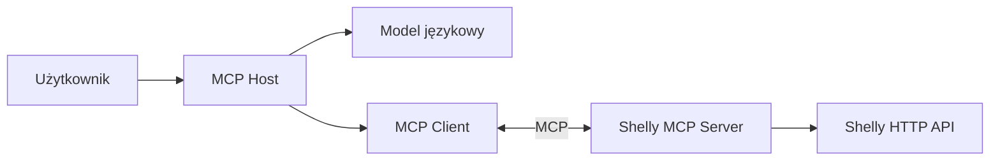
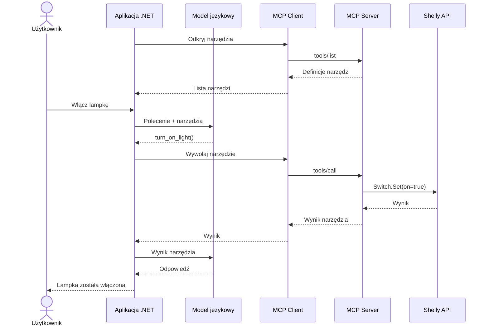

# Tworzenie agentów AI w .NET

## Wykład 04 — Model Context Protocol (MCP)

### Jak udostępniać narzędzia, dane i prompty różnym aplikacjom AI?

---

**Marcin Sulecki**  
marcin.sulecki@pw.edu.pl

## Cel wykładu

Na poprzednim wykładzie poznaliśmy **Tool Calling** — mechanizm pozwalający modelowi językowemu wybierać narzędzia i przekazywać argumenty potrzebne do ich wywołania.

Wiemy już, jak model może odczytać stan lampki, włączyć ją lub wykonać sekwencję operacji.

Pojawia się jednak kolejny problem: każda aplikacja może udostępniać swoje narzędzia w inny sposób.

**Model Context Protocol (MCP)** pozwala udostępniać możliwości aplikacji za pomocą wspólnego protokołu.

Podczas wykładu poznamy:

1. **MCP** — jaki problem integracyjny rozwiązuje?
2. **Architekturę MCP** — czym różnią się Host, Client i Server?
3. **MCP Tools** — jak udostępniać operacje?
4. **MCP Resources** — jak udostępniać dane i kontekst?
5. **MCP Prompts** — jak udostępniać szablony interakcji?
6. **MCP Inspector** — jak korzystać z serwera MCP bez modelu językowego?
7. **Bezpieczeństwo** — jak kontrolować możliwości udostępniane przez serwery MCP?

## 1. Problem integracji

### Czy każde narzędzie musimy integrować osobno?

Podczas poprzedniego wykładu wykorzystaliśmy aplikację .NET do sterowania lampką Shelly.

Model miał dostęp do funkcji:

- `turn_on_light` — włączenie lampki,
- `turn_off_light` — wyłączenie lampki,
- `get_light_status` — odczyt aktualnego stanu.

Teraz wyobraźmy sobie, że chcemy udostępnić te same możliwości:

- aplikacji desktopowej,
- innemu agentowi AI,
- aplikacji napisanej w Pythonie,
- środowisku programistycznemu.

Każda z tych aplikacji mogłaby wymagać osobnej integracji.

Podobny problem występuje przy korzystaniu z:

- baz danych,
- kalendarzy,
- systemów plików,
- repozytoriów kodu,
- urządzeń IoT,
- wewnętrznych systemów przedsiębiorstwa.

**Pytanie przewodnie:**

> Jak udostępnić możliwości aplikacji w taki sposób, aby różni klienci mogli je odkrywać i wykorzystywać?

## 2. Czym jest Model Context Protocol?

**Model Context Protocol (MCP)** to otwarty protokół umożliwiający aplikacjom udostępnianie narzędzi, danych i szablonów interakcji w ustandaryzowany sposób.

MCP nie jest modelem językowym ani mechanizmem podejmowania decyzji.

Określa sposób komunikacji pomiędzy klientem a serwerem udostępniającym określone możliwości.

### Trzy podstawowe mechanizmy MCP

| Mechanizm | Przeznaczenie | Przykład Shelly |
|---|---|---|
| **Tools** | Wykonywanie operacji | Włącz lampkę |
| **Resources** | Udostępnianie danych i kontekstu | Informacje o urządzeniu |
| **Prompts** | Udostępnianie szablonów interakcji | Przygotowanie raportu zużycia energii |

**Kluczowa myśl:**

> MCP standaryzuje sposób udostępniania możliwości aplikacji, a nie sposób rozumowania modelu językowego.

## 3. Architektura MCP

W architekturze MCP występują trzy podstawowe elementy:

| Element | Rola |
|---|---|
| **MCP Host** | Aplikacja zarządzająca połączeniami z serwerami MCP |
| **MCP Client** | Komponent komunikujący się z konkretnym serwerem MCP |
| **MCP Server** | Aplikacja udostępniająca narzędzia, zasoby i prompty |



### Podział odpowiedzialności

**MCP Host** zarządza środowiskiem, w którym wykorzystywane są serwery MCP.

**MCP Client** odpowiada za komunikację z serwerem, odkrywanie jego możliwości i przekazywanie żądań.

**MCP Server** udostępnia możliwości konkretnego systemu.

W naszym przykładzie serwer MCP udostępnia funkcje urządzenia Shelly.

### Czy MCP wymaga modelu językowego?

Nie.

Klient może odkrywać i wykorzystywać możliwości serwera MCP bez udziału LLM.

Model językowy jest potrzebny dopiero wtedy, gdy chcemy wykorzystać te możliwości w procesie interpretacji poleceń i podejmowania decyzji przez model.

## 4. Komunikacja w MCP

MCP definiuje sposób wymiany komunikatów między klientem a serwerem.

Wykorzystuje komunikaty oparte na **JSON-RPC 2.0**.

Komunikacja obejmuje między innymi:

- inicjalizację połączenia,
- uzgadnianie możliwości,
- odkrywanie narzędzi, zasobów i promptów,
- wywoływanie operacji,
- przekazywanie wyników i błędów.

### Odkrywanie możliwości

Klient nie musi znać wszystkich narzędzi serwera w momencie tworzenia aplikacji.

Może zapytać serwer o udostępniane możliwości.

Przykładowe operacje protokołu:

| Operacja | Przeznaczenie |
|---|---|
| `tools/list` | Odkrywanie narzędzi |
| `tools/call` | Wywoływanie narzędzi |
| `resources/list` | Odkrywanie zasobów |
| `resources/read` | Odczytywanie zasobów |
| `prompts/list` | Odkrywanie promptów |
| `prompts/get` | Pobieranie promptów |

### Transport

MCP może wykorzystywać różne mechanizmy transportu, między innymi:

- **stdio** — komunikację przez standardowe wejście i wyjście procesu,
- **Streamable HTTP** — komunikację przez HTTP.

Transport odpowiada za przesyłanie komunikatów, natomiast protokół określa ich znaczenie.

**Pytanie:**

> Czy zmiana sposobu komunikacji z serwerem powinna wymagać zmiany sposobu definiowania jego narzędzi?

## 5. MCP Tools

**Tools** umożliwiają klientom wykonywanie operacji udostępnianych przez serwer MCP.

Przykładowe narzędzia:

- `turn_on_light`,
- `turn_off_light`,
- `get_light_status`,
- `get_power_consumption`.

Każde narzędzie może posiadać:

- nazwę,
- opis,
- schemat argumentów,
- informacje o oczekiwanym wyniku.

### Odkrywanie narzędzi

Klient może pobrać listę dostępnych narzędzi wraz z ich definicjami.

Dzięki temu aplikacja nie musi mieć na stałe zapisanej listy wszystkich funkcji serwera.

### Wywoływanie narzędzi

Po odkryciu narzędzia klient może przekazać do serwera jego nazwę i argumenty.

Serwer odpowiada za obsługę żądania i zwrócenie wyniku.

### MCP Tool a Tool Calling

To dwa różne mechanizmy:

- **MCP Tool** jest możliwością udostępnianą przez serwer MCP.
- **Tool Calling** pozwala modelowi językowemu wskazać narzędzie, którego chce użyć.

Aplikacja może połączyć oba mechanizmy, udostępniając modelowi narzędzia odkryte przez MCP.

**Wniosek:**

> MCP pozwala odkrywać i wywoływać narzędzia, ale nie wymaga modelu językowego do podejmowania decyzji o ich użyciu.

## 6. MCP Resources

**Resources** służą do udostępniania danych i kontekstu.

Mogą reprezentować:

- dokumenty,
- pliki,
- konfigurację,
- informacje o urządzeniach,
- dane pochodzące z systemów zewnętrznych.

### Przykład Shelly

Serwer MCP mógłby udostępnić zasób:

```text
shelly://device/info
```

Przykładowa zawartość:

```json
{
  "name": "Lampka biurkowa",
  "model": "Shelly Plug S Gen3",
  "location": "Pokój 204"
}
```

Klient może odkryć zasób i odczytać jego zawartość.

### Resource a Tool

Informacje o urządzeniu moglibyśmy udostępnić na dwa sposoby:

1. Jako narzędzie `get_device_info`.
2. Jako zasób `shelly://device/info`.

Oba rozwiązania mogą dostarczać podobne dane, ale reprezentują inne sposoby korzystania z możliwości serwera.

| Tool | Resource |
|---|---|
| Reprezentuje operację | Reprezentuje dane lub kontekst |
| Jest wywoływany | Jest odczytywany |
| Może zmieniać stan systemu | Służy do udostępniania zawartości |
| Może być wybierany przez model | Zwykle jest wybierany i dostarczany przez aplikację |

Resources mogą zawierać dane aktualizowane w czasie.

Samo udostępnienie Resource nie oznacza jednak, że jego zawartość zostanie automatycznie przekazana do modelu.

**Pytanie:**

> Czy aktualny stan lampki lepiej udostępnić jako Tool, czy jako Resource?

Nie zawsze istnieje jedna poprawna odpowiedź. Wybór zależy od sposobu wykorzystania informacji.

## 7. MCP Prompts

**Prompts** pozwalają serwerowi MCP udostępniać wielokrotnego użytku szablony interakcji z modelem językowym.

Szablony mogą zawierać:

- instrukcje,
- kontekst,
- przykładowe wiadomości,
- argumenty wpływające na ich zawartość.

### Przykład Shelly

Serwer może udostępnić prompt:

```text
energy-report
```

Jego zadaniem jest przygotowanie instrukcji dotyczących analizy kosztów użytkowania lampki.

Przykładowe argumenty:

- `hours` — liczba godzin użytkowania,
- `pricePerKwh` — cena energii za kWh.

Klient może pobrać szablon, przekazując odpowiednie wartości.

### MCP Prompt a zwykły prompt

| Prompt w aplikacji | MCP Prompt |
|---|---|
| Jest definiowany bezpośrednio w aplikacji | Jest udostępniany przez serwer MCP |
| Aplikacja zarządza jego treścią | Serwer zarządza jego treścią |
| Może być powiązany z konkretną implementacją | Może być wykorzystywany przez różnych klientów |

MCP Prompt nie uruchamia samodzielnie modelu językowego.

Dostarcza wiadomości, które klient może wykorzystać podczas komunikacji z LLM.

**Pytanie:**

> Czy model językowy automatycznie wybiera prompty udostępniane przez MCP?

Nie. W typowym scenariuszu to aplikacja lub użytkownik wybiera prompt, który następnie może zostać przekazany do modelu.

## 8. Tools, Resources i Prompts

Trzy mechanizmy MCP odpowiadają na różne potrzeby.

| | Tools | Resources | Prompts |
|---|---|---|---|
| **Główna rola** | Działanie | Dane i kontekst | Szablon interakcji |
| **Przykład Shelly** | Włącz lampkę | Informacje o urządzeniu | Raport energii |
| **Wykorzystanie** | Wywołanie | Odczyt | Pobranie wiadomości |
| **Czy wymaga LLM?** | Nie | Nie | Nie |

### Przykład — system zarządzania budynkiem

Wyobraźmy sobie system udostępniający:

- sterowanie oświetleniem,
- aktualną temperaturę,
- dokumentację techniczną,
- informacje o pomieszczeniach,
- raporty zużycia energii.

Nie wszystkie te możliwości powinny być reprezentowane jako narzędzia.

Niektóre lepiej udostępnić jako Resources, a inne jako Prompts.

**Kluczowa myśl:**

> Projektowanie serwera MCP polega nie tylko na udostępnianiu funkcji, ale również na świadomym wyborze sposobu prezentowania możliwości systemu.

## 9. MCP Inspector

**MCP Inspector** umożliwia poznawanie i testowanie możliwości serwera MCP.

Pozwala między innymi:

- odkrywać narzędzia,
- sprawdzać ich argumenty,
- wywoływać narzędzia,
- przeglądać zasoby,
- odczytywać ich zawartość,
- przeglądać i pobierać prompty.

### Dlaczego Inspector jest ważny?

Możemy sprawdzić działanie serwera MCP bez uruchamiania modelu językowego.

Pozwala to oddzielić dwa problemy:

1. Czy serwer MCP poprawnie udostępnia swoje możliwości?
2. Czy aplikacja i model poprawnie z nich korzystają?

**Pytanie:**

> Jeśli MCP Inspector poprawnie wywołuje narzędzie, ale model nie potrafi go użyć, gdzie należy szukać przyczyny?

## 10. Tool Calling i MCP — współpraca

Tool Calling i MCP rozwiązują różne problemy.

| Tool Calling | MCP |
|---|---|
| Mechanizm wyboru narzędzi przez model | Protokół udostępniania możliwości aplikacji |
| Model wskazuje narzędzie i argumenty | Klient odkrywa narzędzia i ich schematy |
| Aplikacja odpowiada za wykonanie | Serwer MCP obsługuje wywołanie |
| Nie wymaga MCP | Nie wymaga LLM |

### Przykładowy scenariusz

1. MCP Client odkrywa narzędzia udostępniane przez serwer.
2. Aplikacja przekazuje ich definicje modelowi.
3. Model wybiera odpowiednie narzędzie przez Tool Calling.
4. Aplikacja przekazuje wywołanie do MCP Client.
5. MCP Client komunikuje się z serwerem MCP.
6. Serwer wykonuje operację.
7. Wynik wraca do aplikacji i modelu.



**Wniosek:**

> Tool Calling pozwala modelowi zdecydować, co zrobić. MCP pozwala aplikacji skorzystać z możliwości udostępnianych przez zewnętrzny serwer.

## 11. WebMCP — czy strona internetowa może udostępniać narzędzia agentowi?

Dotychczas rozważaliśmy aplikacje, które udostępniają swoje możliwości
przez serwer MCP.

A co, jeśli agent korzysta z przeglądarki internetowej?

Tradycyjnie agent może wchodzić w interakcję ze stroną przez:

- analizę jej zawartości,
- odczytywanie struktury DOM,
- wyszukiwanie elementów interfejsu,
- symulowanie kliknięć i wpisywania tekstu.

Takie podejście bywa podatne na zmiany wyglądu i struktury strony.

### WebMCP

**WebMCP** to rozwijana propozycja udostępniania agentom
ustrukturyzowanych narzędzi bezpośrednio przez strony internetowe.

Specyfikacja jest rozwijana w ramach W3C Web Machine Learning Community Group:
[WebMCP — projekt specyfikacji](https://webmachinelearning.github.io/webmcp).

Zamiast odtwarzać działania użytkownika przez interfejs,
agent mógłby korzystać z funkcji udostępnionych przez witrynę.

Przykładowo strona uczelni mogłaby udostępniać:

- `search_rooms` — wyszukiwanie sal,
- `get_room_availability` — sprawdzanie dostępności sali,
- `find_building` — wyszukiwanie budynku.

### MCP a WebMCP

| MCP | WebMCP |
|---|---|
| Integracja z serwerami MCP | Integracja z możliwościami strony internetowej |
| Komunikacja przez transport MCP | Interfejs udostępniany w środowisku przeglądarki |
| Narzędzia, Resources i Prompts | Nacisk na narzędzia udostępniane przez witrynę |
| Klient MCP komunikuje się z serwerem | Agent korzysta z możliwości strony przez przeglądarkę |

WebMCP nie jest po prostu kolejnym transportem MCP.
To odrębna, rozwijana propozycja integracji agentów ze stronami WWW.

### Pytanie do dyskusji

> Czy agent powinien klikać przyciski na stronie internetowej,
> czy korzystać z funkcji, które strona udostępnia bezpośrednio?

**Wniosek:**

> Przyszłość integracji agentów może polegać nie tylko na
> interpretowaniu interfejsów użytkownika, ale również na
> udostępnianiu ich możliwości w sposób zrozumiały dla agentów.

## 12. Bezpieczeństwo i zaufanie

MCP ułatwia integrację systemów, ale nie eliminuje zagrożeń związanych z udostępnianiem narzędzi i danych.

Serwer MCP może oferować operacje o istotnych skutkach, takie jak:

- usuwanie plików,
- wysyłanie wiadomości,
- modyfikowanie danych,
- sterowanie urządzeniami.

### Granice zaufania

Warto rozróżnić:

- użytkownika wydającego polecenie,
- aplikację korzystającą z MCP,
- model językowy,
- zewnętrzny serwer MCP,
- system wykonujący operację.

Każdy z tych elementów może mieć inne uprawnienia i poziom zaufania.

### Najważniejsze zagrożenia

- udostępnienie zbyt szerokich uprawnień,
- wykonywanie operacji bez autoryzacji,
- nieprawidłowa walidacja argumentów,
- ujawnienie danych przez Resources,
- złośliwe instrukcje w treści zasobów i promptów,
- niebezpieczne lub mylące opisy narzędzi.

### Czy możemy ufać wszystkim serwerom MCP?

Odkrycie narzędzia nie oznacza, że aplikacja powinna automatycznie pozwolić na jego wykorzystanie.

Podobnie odczytanie Resource nie oznacza, że jego zawartość należy traktować jako zaufane instrukcje.

**Kluczowa zasada:**

> MCP standaryzuje komunikację, ale odpowiedzialność za bezpieczeństwo pozostaje po stronie projektantów i operatorów systemu.

## Podsumowanie

Po wykładzie powinieneś rozumieć:

1. Jaki problem integracyjny rozwiązuje MCP.
2. Czym różnią się MCP Host, Client i Server.
3. Jak działa odkrywanie możliwości serwera.
4. Czym różnią się Tools, Resources i Prompts.
5. Dlaczego MCP nie wymaga modelu językowego.
6. Jak MCP współpracuje z Tool Calling.
7. Jakie zagrożenia należy uwzględnić przy projektowaniu integracji MCP.

### Najważniejsze wnioski

> **Tool Calling pozwala modelowi wybierać narzędzia.**
>
> **MCP pozwala aplikacjom udostępniać i odkrywać narzędzia, dane oraz prompty.**
>
> **MCP nie wymaga LLM, a Tool Calling nie wymaga MCP.**

## Materiały

- [Model Context Protocol — dokumentacja](https://modelcontextprotocol.io/)
- [MCP — Tools](https://modelcontextprotocol.io/specification/2025-06-18/server/tools)
- [MCP — Resources](https://modelcontextprotocol.io/specification/2025-06-18/server/resources)
- [MCP — Prompts](https://modelcontextprotocol.io/specification/2025-06-18/server/prompts)
- [MCP Inspector](https://github.com/modelcontextprotocol/inspector)
- [Model Context Protocol — C# SDK](https://github.com/modelcontextprotocol/csharp-sdk)
- [WebMCP — projekt specyfikacji](https://webmachinelearning.github.io/webmcp)

## Laboratorium

Praktyczne wykorzystanie MCP omówimy podczas:

[Laboratorium 05 — MCP](../../labs/05-mcp/README.md).

## Na kolejnym wykładzie

### Skills — jak udostępniać agentowi wiedzę o sposobie wykonywania zadań?

Poznaliśmy mechanizmy udostępniania funkcji, danych i szablonów interakcji.

Na kolejnym wykładzie zajmiemy się **Skills** — sposobem organizowania instrukcji i procedur, z których agent może korzystać podczas realizacji zadań.

Zastanowimy się również, czym Skills różnią się od narzędzi i promptów MCP.