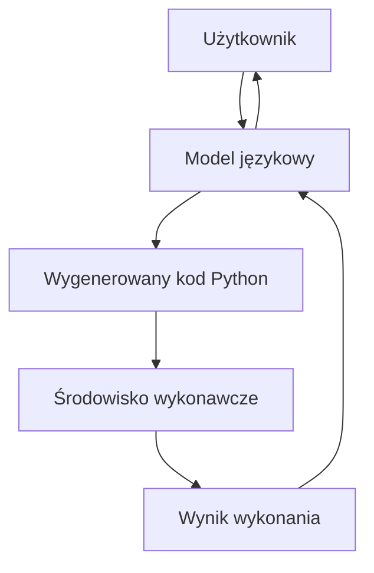
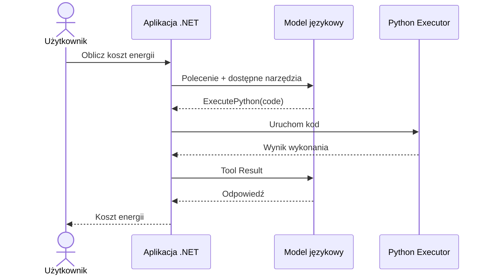
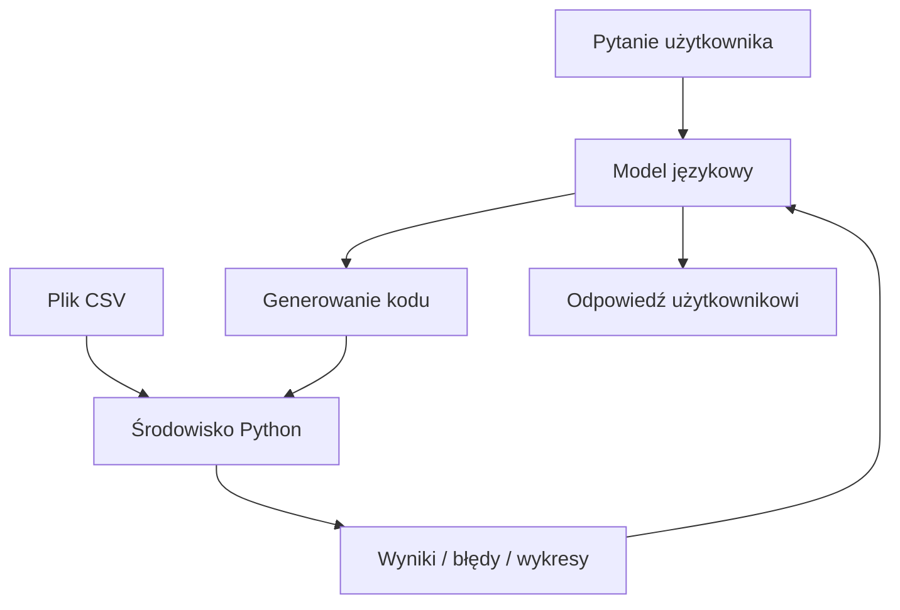
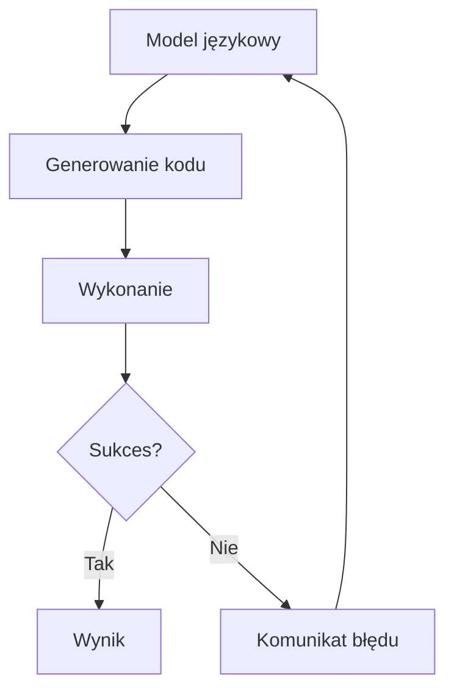
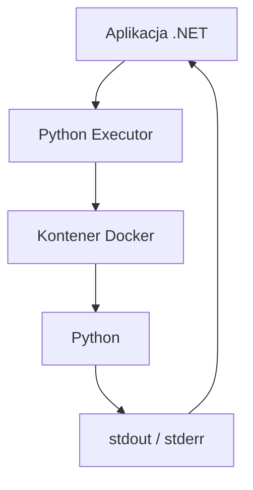

# Tworzenie agentów AI w .NET

## Wykład 06 — Code Execution

### Co zrobić, gdy agent nie ma gotowego narzędzia do rozwiązania problemu?

---

**Marcin Sulecki**  
marcin.sulecki@pw.edu.pl

## Cel wykładu

Na poprzednim wykładzie poznaliśmy **Tool Calling** i **MCP** — mechanizmy pozwalające modelom językowym korzystać z narzędzi udostępnionych przez aplikacje.

Ale czy programista musi przewidzieć wszystkie operacje, których użytkownik może potrzebować?

Podczas tego wykładu zobaczymy, jak model językowy może **generować kod, uruchamiać go w kontrolowanym środowisku i wykorzystywać wyniki do rozwiązywania problemów**.

Poznamy:

1. **Code Generation** — jak model generuje kod na podstawie polecenia?
2. **Code Execution** — jak aplikacja uruchamia kod wygenerowany przez model?
3. **Tool Calling** — jak wykorzystać mechanizm wywoływania narzędzi do wykonywania kodu?
4. **Iteracyjne poprawianie kodu** — jak model może reagować na błędy wykonania?
5. **Sandboxing** — jak ograniczać możliwości wykonywanego kodu?
6. **Zastosowania** — kiedy Code Execution jest lepszym rozwiązaniem niż gotowe narzędzia?

## 1. Czy agent potrzebuje narzędzia do każdego zadania?

Wróćmy do przykładu inteligentnego gniazdka **Shelly Plug S Gen3**.

Nasz model potrafi już:

- włączyć lampkę,
- wyłączyć lampkę,
- odczytać jej stan,
- sprawdzić aktualny pobór mocy.

Użytkownik pyta:

> Ile kosztuje świecenie mojej lampki przez 500 godzin przy cenie 4,50 zł/kWh?

Agent może odczytać moc lampki, ale nie ma narzędzia obliczającego koszt energii.

Co możemy zrobić?

### Trzy podejścia

| Podejście | Rozwiązanie |
|---|---|
| LLM | Model samodzielnie wykonuje obliczenia i podaje wynik. |
| Tool Calling | Programista przygotowuje funkcję `CalculateEnergyCost`. |
| Code Execution | Model generuje kod obliczający koszt i uruchamia go. |

**Pytanie:** które rozwiązanie wybrać i dlaczego?

> **Nie każde zadanie wymaga Code Execution. Czasami zwykła funkcja jest prostsza, szybsza i bezpieczniejsza.**

## 2. Code Generation a Code Execution

Warto rozróżnić dwa pojęcia.

### Code Generation

Model generuje kod źródłowy.

Przykładowo:

```python
power_w = 8.5
hours = 500
price_per_kwh = 4.50

energy_kwh = power_w * hours / 1000
cost = energy_kwh * price_per_kwh

print(f"Zużycie energii: {energy_kwh:.2f} kWh")
print(f"Koszt: {cost:.2f} PLN")
```

Wygenerowanie kodu nie oznacza jednak, że został on wykonany.

### Code Execution

Aplikacja przekazuje wygenerowany kod do środowiska wykonawczego.

Środowisko uruchamia program i zwraca jego wynik.



> **Model generuje kod, ale to środowisko wykonawcze odpowiada za jego uruchomienie.**

## 3. Code Execution przez Tool Calling

Nie potrzebujemy osobnego protokołu komunikacji z modelem.

Możemy wykorzystać poznany wcześniej mechanizm **Tool Calling**.

Przykładowe narzędzie:

```csharp
[Description("Executes Python code and returns its output.")]
Task<string> ExecutePython(
    [Description("Python source code to execute")] string code);
```

Model otrzymuje opis narzędzia i może zdecydować o jego użyciu.

Przykładowe wywołanie:

```json
{
  "code": "print(8.5 * 500 / 1000 * 4.50)"
}
```

Aplikacja:

1. Odbiera kod wygenerowany przez model.
2. Przekazuje go do środowiska wykonawczego.
3. Uruchamia kod.
4. Odbiera wynik lub komunikat błędu.
5. Przekazuje rezultat do modelu.

### Architektura



**Pytanie:** czy model musi wiedzieć, w jaki sposób aplikacja uruchamia Pythona?

## 4. Demonstracja — Shelly i Python

Wykorzystamy aplikację:

`06-Shelly.CodeExecution`

Agent otrzyma dwa narzędzia:

- `GetLightStatus` — odczyt aktualnego stanu i mocy lampki,
- `ExecutePython` — wykonanie kodu Pythona.

Użytkownik pyta:

> Ile kosztuje świecenie mojej lampki przez 500 godzin przy cenie 4,50 zł/kWh?

Agent powinien:

1. Odczytać moc urządzenia.
2. Wygenerować odpowiedni kod.
3. Uruchomić kod.
4. Odczytać wynik.
5. Przedstawić odpowiedź.

**Pytanie:** czy agent powinien wykonywać kod, jeśli wynik można uzyskać prostym obliczeniem?

## 5. Analiza danych — kiedy Code Execution ma sens?

Wyobraźmy sobie aplikację analizującą dane z pliku CSV.

Użytkownik może zadawać różne pytania:

> Jaka jest średnia wartość zamówienia?

> Który dzień miał największą sprzedaż?

> Znajdź nietypowe wartości.

> Oblicz średnią kroczącą z ostatnich 7 dni.

> Wygeneruj wykres sprzedaży.

Możemy przygotować osobne narzędzie do każdego pytania.

Ale czy jesteśmy w stanie przewidzieć wszystkie możliwe operacje?

### Alternatywa

Udostępniamy agentowi środowisko pozwalające wykonywać kod Pythona.

Model może:

1. Przeanalizować pytanie.
2. Wygenerować kod wykorzystujący dostępne dane.
3. Uruchomić program.
4. Odczytać wynik.
5. W razie potrzeby wykonać kolejne obliczenia.



**Kluczowa myśl:** Code Execution jest szczególnie przydatny, gdy zakres możliwych operacji jest trudny do przewidzenia.

## 6. Iteracyjne poprawianie kodu

Model nie zawsze wygeneruje poprawny program za pierwszym razem.

Przykładowy przebieg:

1. Model generuje kod.
2. Aplikacja próbuje go uruchomić.
3. Python zwraca komunikat błędu.
4. Model analizuje błąd.
5. Model generuje poprawioną wersję.
6. Aplikacja ponownie wykonuje kod.



### Pytania

- Ile prób poprawienia kodu powinien otrzymać agent?
- Co zrobić, jeśli model powtarza ten sam błąd?
- Czy poprawne wykonanie programu oznacza poprawność obliczeń?
- Kto odpowiada za weryfikację wyniku?

> **Brak błędu wykonania nie oznacza, że program działa poprawnie.**

## 7. Bezpieczeństwo — czy można ufać wygenerowanemu kodowi?

Kod wygenerowany przez model może zawierać:

- błędy,
- nieskończone pętle,
- operacje na plikach,
- próby dostępu do sieci,
- niebezpieczne polecenia systemowe,
- operacje zużywające nadmierne zasoby.

Nie powinniśmy uruchamiać takiego kodu bezpośrednio w procesie aplikacji.

### Sandboxing

Jednym ze sposobów ograniczania ryzyka jest wykonywanie kodu w izolowanym środowisku.

W naszych przykładach wykorzystamy kontenery **Docker**.



### Przykładowe zabezpieczenia

| Mechanizm | Cel |
|---|---|
| Izolacja procesu | Oddzielenie wykonywanego kodu od aplikacji |
| Limit czasu | Przerwanie zbyt długo działającego programu |
| Limit pamięci | Ograniczenie zużycia RAM |
| Limit CPU | Ograniczenie wykorzystania procesora |
| Brak dostępu do sieci | Ograniczenie komunikacji z zewnętrznymi usługami |
| Ograniczone uprawnienia | Zmniejszenie możliwości ingerencji w środowisko |
| Kontrola plików | Ograniczenie dostępu do danych |

**Ważne:** sam Docker nie stanowi pełnej granicy bezpieczeństwa. W systemach produkcyjnych potrzebne są dodatkowe mechanizmy izolacji i kontroli.

### Pytanie do dyskusji

> Czy pozwolilibyśmy agentowi wykonać dowolny kod na komputerze, na którym przechowujemy prywatne dane?

## 8. Kiedy stosować Code Execution?

| Sytuacja | Preferowane rozwiązanie |
|---|---|
| Włączenie lampki | Tool Calling |
| Odczyt danych z API | Tool Calling / MCP |
| Proste, powtarzalne obliczenia | Dedykowana funkcja |
| Analiza danych o nieprzewidzianej strukturze | Code Execution |
| Złożone przekształcenia danych | Code Execution |
| Generowanie wykresów | Code Execution |
| Operacje o wysokim ryzyku | Kontrolowane, dedykowane narzędzia |

Nie chodzi o zastąpienie wszystkich narzędzi generowanym kodem.

Chodzi o świadomy wybór odpowiedniego mechanizmu.

> **Największą zaletą Code Execution jest elastyczność. Największym wyzwaniem — kontrola wykonywanego kodu.**

## Podsumowanie

Po wykładzie powinieneś rozumieć:

1. Czym różni się Code Generation od Code Execution.
2. Jak wykorzystać Tool Calling do uruchamiania wygenerowanego kodu.
3. Kiedy Code Execution ma przewagę nad gotowymi funkcjami.
4. Jak agent może analizować błędy i poprawiać kod.
5. Dlaczego wykonywanie kodu wymaga izolacji.
6. Jakie ograniczenia należy nakładać na środowisko wykonawcze.
7. Dlaczego wynik działania programu nadal wymaga weryfikacji.

### Najważniejsze wnioski

> **Tool Calling pozwala modelowi korzystać z przygotowanych narzędzi.**
>
> **Code Execution pozwala modelowi generować programy rozwiązujące nowe problemy.**
>
> **To aplikacja odpowiada za kontrolę wykonania i bezpieczeństwo.**

## Materiały

- [OpenAI — Code Interpreter](https://platform.openai.com/docs/guides/tools-code-interpreter)
- [Docker — dokumentacja](https://docs.docker.com/)
- [Testcontainers for .NET](https://dotnet.testcontainers.org/)
- [Microsoft.Extensions.AI](https://learn.microsoft.com/dotnet/ai/microsoft-extensions-ai)

## Laboratorium

Podczas laboratorium wykorzystamy Code Execution do analizy danych.

Porównamy trzy podejścia:

1. Obliczenia wykonywane bezpośrednio przez model.
2. Obliczenia realizowane przez dedykowane funkcje C#.
3. Generowanie i wykonywanie kodu Pythona.

Sprawdzimy również, jak agent reaguje na błędy wykonania i jakie ograniczenia powinno mieć środowisko uruchamiające kod.

**[Laboratorium 07 — Code Execution →](../../labs/07-code-execution/README.md)**

## Na kolejnym wykładzie

### Architektura agentów AI — jak połączyć wszystkie elementy?

Poznaliśmy już:

- modele językowe,
- prompting,
- Tool Calling,
- MCP,
- Code Execution.

Potrafimy udostępniać modelowi narzędzia i wykonywać wygenerowany kod.

Ale czy to wystarczy, aby zbudować agenta?

Na kolejnym wykładzie zajmiemy się:

- realizacją celów wymagających wielu działań,
- pętlą obserwacji i podejmowania decyzji,
- planowaniem,
- zarządzaniem stanem,
- weryfikacją rezultatów,
- obsługą błędów.

**[Wykład 09 — Architektura agentów AI →](../09-architektura-agentow/README.md)**

> **Agent to nie tylko model z dostępem do narzędzi. To system, który potrafi wykorzystać dostępne możliwości do realizacji celu.**